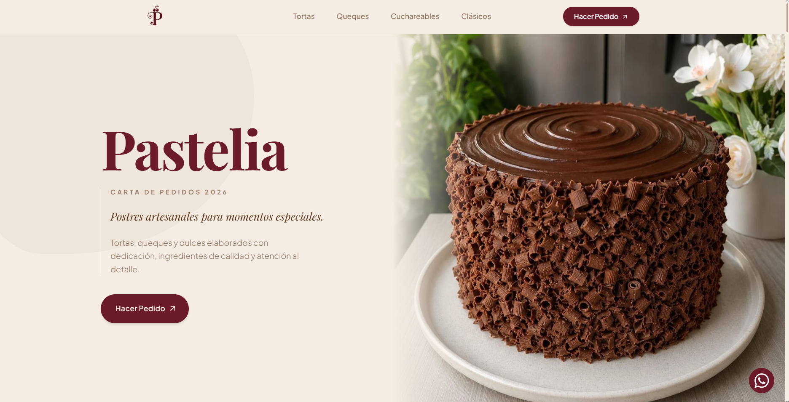

# Pastelia Landing Page 🍰




Una landing page moderna, dinámica y altamente atractiva para **Pastelia**, especializada en repostería artesanal (tortas, queques, clásicos y cuchareables). El proyecto destaca por un enfoque premium en diseño de interfaz (UI), utilizando animaciones fluidas y *smooth scrolling* para brindar una experiencia de usuario (UX) excepcional.

---

## 🚀 Características Principales

- **Diseño Premium y Responsivo**: Adaptado perfectamente a dispositivos móviles, tablets y escritorio.
- **Smooth Scrolling**: Navegación suave por toda la página gracias a la integración con [Lenis](https://lenis.studiofreight.com/).
- **Animaciones Avanzadas**: Micro-interacciones, transiciones de entrada y efectos visuales atractivos construidos sobre [Framer Motion](https://www.framer.com/motion/).
- **Estructura Modular**: Código altamente mantenible dividido en secciones y componentes UI reutilizables (Botones magnéticos, cursores personalizados, lightboxes, etc.).
- **Enrutamiento**: Navegación ágil entre la página de inicio y el catálogo utilizando `react-router-dom`.
- **Estilizado de Vanguardia**: Implementado íntegramente con el nuevo **Tailwind CSS v4**.

---

## 🛠️ Stack Tecnológico

- **Framework**: [React 19](https://react.dev/)
- **Build Tool**: [Vite](https://vitejs.dev/)
- **Estilos**: [Tailwind CSS v4](https://tailwindcss.com/)
- **Animaciones**: [Framer Motion](https://www.framer.com/motion/)
- **Scroll Suave**: [Lenis](https://github.com/studio-freight/lenis)
- **Iconografía**: [Lucide React](https://lucide.dev/)
- **Routing**: [React Router v7](https://reactrouter.com/)


---

## ⚙️ Instalación y Uso Local

Sigue estos pasos para levantar el entorno de desarrollo en tu máquina local.

1. **Clona el repositorio** y navega a la carpeta del proyecto:
   ```bash
   git clone https://github.com/jhefferson-guerrero/pastelia-landing.git
   cd pastelia-landing
   ```

2. **Instala las dependencias**:
   Asegúrate de tener [Node.js](https://nodejs.org/) instalado. Ejecuta el siguiente comando en la raíz del proyecto:
   ```bash
   npm install
   ```

3. **Inicia el servidor de desarrollo**:
   ```bash
   npm run dev
   ```

---

## 📜 Scripts Disponibles

En el directorio del proyecto puedes ejecutar:

- `npm run dev`: Inicia el servidor de desarrollo local con Hot-Module-Replacement (HMR).
- `npm run build`: Compila la aplicación para producción generando los estáticos optimizados en la carpeta `dist/`.
- `npm run preview`: Levanta un servidor web local para visualizar el *build* de producción generado.

---

